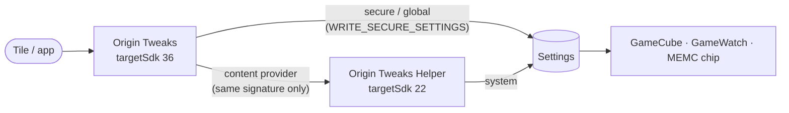

<div align="center">


# Origin Tweaks

**One-tap frame generation for vivo / iQOO on OriginOS**

Quick Settings tile · Force 144 FPS in any game · Per-game profiles · Restores everything when turned off

[](https://github.com/Teemo4621/origin-tweaks/actions/workflows/ci.yml)
[](https://github.com/Teemo4621/origin-tweaks/actions/workflows/release.yml)


[ภาษาไทย](README.md) · **English**

</div>

---

## ✨ Features

| | |
|---|---|
|  **Quick Settings tile** | Tap to cycle **Off → 90 → 120 → 144 FPS**. The tile's label and icon always show the current state; long-press opens the app |
|  **Works in any game** | Turns on frame generation even for games GameCube doesn't support |
|  **Per-game profiles** | Set an FPS per game; it switches on when you open the game and reverts when you leave |
|  **Overwrite protection** | If GameCube resets the values when a game starts, the app sets them back |
|  **Full restore** | Every original value is saved before turning on and restored when turning off |
|  **Auto setup** | One tap through Shizuku, once. Shizuku isn't needed after that |
|  **In-app updates** | Checks GitHub Releases when the app opens. Tap Update to download, verify the SHA-256 and open the system installer |

> [!NOTE]
> The **144 FPS** set is the one tested by the community on the iQOO 15. 90 / 120 FPS use the same format but are untested.

## 📱 Supported devices

- **Tested:** iQOO 15 (PD2505) · OriginOS 6 / Android 16
- **Likely to work:** vivo / iQOO models with GameCube and the same display (MEMC) chip
- Requires Android 10 or later

## 🚀 Install

1. Install **[Shizuku](https://shizuku.rikka.app/)** and start it via Wireless debugging
2. Download `OriginTweaks-vX.Y.Z-arm64.apk` from **[Releases](../../releases)** and install it normally
3. Open the app → tap **Auto setup** → allow Shizuku
4. Turn on **Usage access** for Origin Tweaks (the app opens the page for you; only needed for per-game profiles)
5. Pull down the panel → tap the edit icon → drag the **Frame generation** tile into place

You can stop Shizuku afterwards.

<details>
<summary><b>Install from a computer (adb) instead of Shizuku</b></summary>

```bash
adb install OriginTweaks-vX.Y.Z-arm64.apk
adb shell pm grant dev.origintweaks.origin_tweaks android.permission.WRITE_SECURE_SETTINGS
```

Then open the app and tap **Auto setup** to install the helper (this step still needs Shizuku).

</details>

## 🧠 How it works

OriginOS silently drops `settings put` commands coming from adb / Shizuku, and Android only lets apps that **target SDK 22** write non-public system keys. The app is therefore split in two:



- **Origin Tweaks** (main app) is a regular app that installs normally and provides the UI, the tile and profiles
- **Origin Tweaks Helper** is bundled inside the main app and installed automatically through Shizuku (`pm install --bypass-low-target-sdk-block`). It has no icon, only accepts calls from an app signed with the same key, and can change only 7 specific keys

<details>
<summary><b>Values written when turning on 144 FPS</b></summary>

| Namespace | Key | Value |
|---|---|---|
| system | `gamecube_frame_interpolation_for_sr` | `1:1::48:144` |
| secure | `gamecube_super_resolution` | `2:` |
| system | `vivo_sr_status` | `2` |
| global | `xpq_value_from_gamecube` | `1` |
| global | `vsr_value_from_gamecube` | `1` |
| system | `nova_memc_status` | `1` |
| system | `vivo_fullscreen_flag` | `1` |
| system | `memc_main_switch_setting` | `1` |
| system | `gamewatch_game_target_fps` | `144` |
| secure | `gamecube_force_bypass_mode` | `0` |

When turned off, every value saved beforehand is restored.

</details>

## 🛠️ Development

Requires Flutter 3.44 and JDK 17 or later.

```bash
flutter pub get
flutter analyze
flutter test
flutter build apk --debug
cd android && ./gradlew :app:testDebugUnitTest
```

```
lib/                     Flutter UI (Frame generation · Profiles · Setup)
android/app/             Main app: tile, service, Shizuku, FrameGen
android/helper/          targetSdk 22 helper (embedded in the main APK at build time)
.github/workflows/       CI and release
```

## ⚠️ Good to know

- The app changes system settings; if vivo changes these keys in a ROM update, the app may stop working
- The actual effect depends on whether the display chip and system support that game and FPS
- Use at your own risk. Not affiliated with vivo / iQOO

## 🙏 Credits

- The 144 FPS values come from the Tasker project by **I_ViveK_I** (iQOO community)
- [Shizuku](https://github.com/RikkaApps/Shizuku) by RikkaApps
