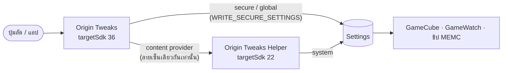

<div align="center">


# Origin Tweaks

**แทรกเฟรม (Frame Generation) แบบกดปุ่มเดียว สำหรับ vivo / iQOO บน OriginOS**

ปุ่มลัดใน panel · บังคับ 144 FPS ได้ทุกเกม · Profile รายเกม · ปิดแล้วคืนค่าเดิมทั้งหมด

[](https://github.com/Teemo4621/origin-tweaks/actions/workflows/ci.yml)
[](https://github.com/Teemo4621/origin-tweaks/actions/workflows/release.yml)


</div>

---

## ✨ ความสามารถ

| | |
|---|---|
| ⚡ **ปุ่มลัดใน panel** | แตะเพื่อวน **ปิด → 90 → 120 → 144 FPS** ชื่อปุ่มและไอคอนบอกสถานะตลอด กดค้างเพื่อเปิดแอป |
| 🎮 **บังคับทุกเกม** | เปิดเฟรมเจนได้แม้เกมนั้น GameCube ไม่รองรับ |
| 🗂️ **Profile รายเกม** | ตั้ง FPS แยกแต่ละเกม เข้าเกมแล้วเปิดให้เอง ออกจากเกมแล้วคืนค่า |
| 🔁 **กันค่าโดนเขียนทับ** | ถ้า GameCube รีเซ็ตค่าตอนเข้าเกม แอปจะตั้งกลับให้ |
| ↩️ **คืนค่าเดิมครบ** | จดค่าเดิมทุกตัวไว้ก่อนเปิด และคืนให้ทั้งหมดตอนปิด |
| 🪄 **ตั้งค่าอัตโนมัติ** | กดปุ่มเดียวผ่าน Shizuku ครั้งแรกครั้งเดียว หลังจากนั้นไม่ต้องใช้ Shizuku อีก |

> [!NOTE]
> ค่า **144 FPS** คือชุดค่าที่ community ทดสอบแล้วบน iQOO 15 ส่วน 90 / 120 FPS ใช้รูปแบบเดียวกันแต่ยังไม่ได้ทดสอบ

## 📱 อุปกรณ์ที่รองรับ

- **ทดสอบแล้ว:** iQOO 15 (PD2505) · OriginOS 6 / Android 16
- **น่าจะใช้ได้:** vivo / iQOO รุ่นที่มี GameCube และชิปภาพ (MEMC) แบบเดียวกัน
- ต้องใช้ Android 10 ขึ้นไป

## 🚀 ติดตั้ง

1. ติดตั้ง **[Shizuku](https://shizuku.rikka.app/)** แล้วกด Start ผ่าน Wireless debugging
2. ดาวน์โหลด `OriginTweaks-vX.Y.Z-arm64.apk` จากหน้า **[Releases](../../releases)** แล้วกดติดตั้งตามปกติ
3. เปิดแอป → กด **ตั้งค่าอัตโนมัติ** → อนุญาต Shizuku
4. เปิดสวิตช์ **Usage access** ให้ Origin Tweaks (แอปจะเปิดหน้านี้ให้ ใช้แค่กับ Profile รายเกม)
5. เลื่อน panel ลง → แตะไอคอนแก้ไข → ลากปุ่ม **แทรกเฟรม** ขึ้นไปวาง

เสร็จแล้วปิด Shizuku ได้เลย

<details>
<summary><b>ติดตั้งผ่านคอม (adb) แทน Shizuku</b></summary>

```bash
adb install OriginTweaks-vX.Y.Z-arm64.apk
adb shell pm grant dev.origintweaks.origin_tweaks android.permission.WRITE_SECURE_SETTINGS
```

จากนั้นเปิดแอปแล้วกด **ตั้งค่าอัตโนมัติ** เพื่อติดตั้งตัวช่วย (ยังต้องใช้ Shizuku สำหรับขั้นตอนนี้)

</details>

## 🧠 ทำงานอย่างไร

OriginOS ทิ้งคำสั่ง `settings put` ที่มาจาก adb / Shizuku แบบเงียบๆ และ Android ยอมให้เฉพาะแอปที่ **targetSdk 22** เขียน key ของระบบที่ไม่ใช่ public ได้ แอปจึงแยกเป็น 2 ส่วน



- **Origin Tweaks** (แอปหลัก) เป็นแอปปกติ ติดตั้งง่าย มี UI ปุ่มลัด และ Profile
- **Origin Tweaks Helper** ฝังอยู่ในแอปหลัก ติดตั้งให้อัตโนมัติผ่าน Shizuku (`pm install --bypass-low-target-sdk-block`) ไม่มีไอคอน รับคำสั่งเฉพาะจากแอปที่เซ็นด้วย key เดียวกัน และแก้ได้แค่ 6 key ที่กำหนด

<details>
<summary><b>ค่าที่แอปเขียนเมื่อเปิด 144 FPS</b></summary>

| หมวด | Key | ค่า |
|---|---|---|
| system | `gamecube_frame_interpolation` | `1:106::48:144` |
| secure | `gamecube_super_resolution` | `2:` |
| system | `vivo_sr_status` | `2` |
| global | `xpq_value_from_gamecube` | `1` |
| global | `vsr_value_from_gamecube` | `1` |
| system | `nova_memc_status` | `1` |
| system | `vivo_fullscreen_flag` | `1` |
| system | `memc_main_switch_setting` | `1` |
| system | `gamewatch_game_target_fps` | `144` |
| secure | `gamecube_force_bypass_mode` | `0` |

ตอนปิด แอปจะคืนค่าที่จดไว้ก่อนเปิดให้ทุกตัว

</details>

## 🛠️ พัฒนาต่อ

ต้องมี Flutter 3.44 และ JDK 17 ขึ้นไป

```bash
flutter pub get
flutter analyze
flutter test
flutter build apk --debug
cd android && ./gradlew :app:testDebugUnitTest
```

```
lib/                     Flutter UI (หน้าแทรกเฟรม · Profile · ตั้งค่า)
android/app/             แอปหลัก: ปุ่มลัด, service, Shizuku, FrameGen
android/helper/          ตัวช่วย targetSdk 22 (ฝังใน APK หลักตอน build)
.github/workflows/       CI และ release
```

### Release

กด tag แล้ว push เช่น `git tag v1.0.0 && git push origin v1.0.0` ระบบจะ build APK แล้วสร้าง GitHub Release ให้

ถ้าจะเซ็นด้วย key ของตัวเอง ให้ตั้ง secrets ใน repo นี้:

| Secret | ค่า |
|---|---|
| `KEYSTORE_BASE64` | ไฟล์ `.jks` ที่แปลงเป็น base64 |
| `KEYSTORE_PASSWORD` | รหัสผ่าน keystore |
| `KEY_ALIAS` | ชื่อ alias ของ key |
| `KEY_PASSWORD` | รหัสผ่านของ key |

> [!IMPORTANT]
> ถ้าไม่ตั้ง secrets ระบบจะเซ็นด้วย debug key ชั่วคราว ซึ่ง release ถัดไปจะอัปเดตทับไม่ได้ (ต้องถอนแล้วติดตั้งใหม่) ควรตั้ง key ก่อนแจกจริง และเก็บ keystore ไว้ให้ดี

## ⚠️ ข้อควรรู้

- แอปแก้ค่า settings ของระบบ ถ้า vivo อัปเดตรอมแล้วเปลี่ยน key แอปอาจใช้ไม่ได้
- ผลจริงขึ้นกับว่าชิปภาพและระบบรองรับเกมและ FPS นั้นหรือไม่
- ใช้งานด้วยความเสี่ยงของตัวเอง ไม่ได้เกี่ยวข้องกับ vivo / iQOO

## 🙏 เครดิต

- ชุดค่า 144 FPS มาจาก Tasker project ของ **I_ViveK_I** (community iQOO)
- [Shizuku](https://github.com/RikkaApps/Shizuku) โดย RikkaApps
